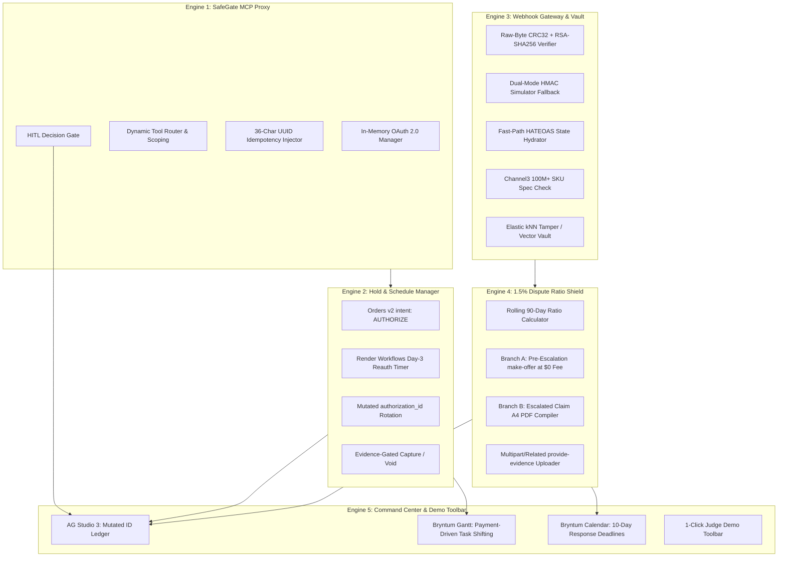

# 🛡️ PayPal Aegis

> **Autonomous Milestone Escrow, Delivery Verification & Dispute Compliance Operating System**  
> *Built for the PayPal AI Hackathon: Build What's Next with PayPal & AI (2026)*

[](LICENSE)
[](https://developer.paypal.com)
[](https://www.typescriptlang.org)
[](https://nextjs.org)
[](https://www.ag-grid.com)
[](https://bryntum.com)
[](https://channel3.dev)
[](https://render.com)

---

## 1. Executive Summary & Problem Solved

Digital agencies, software contractors, custom manufacturers, and B2B merchants face severe, asymmetric vulnerabilities within PayPal’s commercial ecosystem:

1. **The Intangible Goods Vulnerability & The 1.5% Dispute Cliff:**  
   Unlike physical retail packages with carrier barcodes, digital milestones and software receive **zero coverage** for *Significantly Not As Described* (SNAD) disputes under US Seller Protection. If a merchant's rolling 3-month dispute ratio crosses **1.5%** over 100+ sales, PayPal moves the account into the **High Volume Tier**, assessing a **$30 non-refundable penalty fee per claim**—even when the merchant proves delivery and wins.
2. **The 3-Day Hold Bug & Mutated Authorization ID:**  
   Standard two-step PayPal authorizations (`intent: "AUTHORIZE"`) carry a strict 3-day **Honor Period** before capture reliability degrades. Calling the `/reauthorize` endpoint between Days 4 and 29 returns a **brand-new `authorization_id`**. Naive systems fail to update this mutated foreign key, leading to capture failures.
3. **The Unguarded AI Agent Toolkit:**  
   PayPal’s `@paypal/agent-toolkit` and MCP server (`mcp.paypal.com`) default to live production (`sandbox: false`), lack human confirmation gates before money-moving tools (`pay_order`, `create_refund`, `accept_dispute_claim`), and provide tools to surrender disputes but **zero tools to fight them** (`provide-evidence` or `make-offer`).

**PayPal Aegis** unifies two-step milestone holds, operational Gantt timelines, multimodal delivery verification, and automated chargeback representment behind a deterministic **Human-in-the-Loop (HITL) AI Security Firewall**.

---

## 2. Five Core Engines Architecture



### Engine 1: SafeGate Deterministic MCP Firewall & Proxy
* **Sandbox Lock:** Hardcodes `sandbox: true` preventing accidental live API execution.
* **In-Memory OAuth 2.0 Token Manager:** Auto-refreshes tokens 15 minutes before expiration with thread-safe request coalescing.
* **36-Character UUID Idempotency:** Injects `PayPal-Request-Id` headers within PayPal's 38-char limit and maintains a local response snapshot cache to preserve audit trails.
* **HITL Approval Gate:** Intercepts `pay_order`, `capture_authorization`, `void_authorization`, `make_dispute_offer`, and `provide_dispute_evidence` in a `PENDING_APPROVAL` queue.

### Engine 2: Two-Step Milestone Authorization & Day-3 Hold Manager
* **Order Creation:** Generates milestone orders with `intent: "AUTHORIZE"`.
* **Day-3 Pointer Rotation:** Schedules durable 72-hour timers in Render Workflows. When reauthorized, captures the newly minted `authorization_id`, updates active pointers atomically, and archives the superseded ID.
* **Evidence-Gated Capture:** Executes partial captures (`final_capture: false`) against the active mutated ID upon deliverable verification.

### Engine 3: Raw-Byte Webhook Gateway, HATEOAS Hydrator & Audit Vault
* **Raw-Byte CRC32 Verification:** Ingests raw body byte buffers before web framework JSON normalization, computing unsigned 32-bit CRC32 checksums and verifying `RSA-SHA256` signatures against cached PayPal PEM certificates.
* **Dual-Mode Handler:** Automatically uses CRC32/RSA for live sandbox webhooks and HMAC-SHA256 for simulated judge demo events.
* **Channel3 & Elastic Verification:** Queries Channel3’s 100M+ catalog items for canonical SKU specs and runs Elastic kNN vector similarity to ensure deliverable proof photos are not reused internet stock images.

### Engine 4: 1.5% Dispute Ratio Shield & Evidence Compiler
* **Rolling 90-Day Ratio Radar:** Real-time tracking of dispute frequency relative to the 1.5% High Volume penalty threshold ($30 fee per claim).
* **Branch A (Pre-Escalation Inquiry Settlement):** When ratio is near 1.5%, routes inquiries to `POST /v1/customer/disputes/{id}/make-offer` ($0 Dispute Fee) to prevent account elevation to the $30 penalty tier.
* **Branch B (Escalated Claim Multipart Defense):** Automatically compiles client IP logs, download timestamps, SOW signatures, and deliverable SHA-256 hashes into a single-orientation A4 PDF strictly under 10 MB, dispatched via `multipart/related; boundary=---AegisBoundary`.

### Engine 5: Unified Command Center & 1-Click Judge Demo Toolbar
* **AG Studio 3:** Live dispute radar, mutated authorization ID ledger, and accessible HITL approval drawer.
* **Bryntum Gantt & Calendar:** Payment-driven milestone shifting and 10-day seller response deadline countdowns.
* **1-Click Judge Demo Toolbar:** 4 deterministic fixture buttons to audit the entire system in under 60 seconds.

---

## 3. Targeted Hackathon Prize Tracks

| Prize Category | Role in PayPal Aegis Architecture |
|---|---|
| **Overall 1st / 2nd / 3rd ($25,000 pool)** | Full-stack production operating system solving real merchant loss vectors with type safety and zero-friction demo mode. |
| **Best Use of Agentic Commerce ($5,000)** | Grounded agentic execution combining Channel3 product discovery, deterministic PayPal Orders v2 holds, and safe HITL approval gates. |
| **Best Use of PayPal + AI ($5,000)** | SafeGate firewall wrapping `@paypal/agent-toolkit` with sandbox locking, dynamic tool context scoping, and dispute defense. |
| **Best Use of AG Grid / AG Studio ($10,000 pool)** | AG Studio 3 custom widgets, live 1.5% dispute ratio radar, and mutated authorization ID ledger. |
| **Best Use of Bryntum ($3,000 pool)** | Bryntum Gantt payment-driven downstream task shifting and Bryntum Calendar 10-day dispute deadline tracking. |
| **Best Use of APIMatic ($3,000 pool)** | APIMatic Context Plugin schema grounding preventing LLM hallucinations across v1/v2 endpoints. |
| **Best Use of Channel3 ($1,500)** | 100M+ catalog SKU verification and replacement pricing for B2B physical deliverables. |
| **Best Use of Render ($2,250 credits pool)** | Full-stack deployment blueprint with Render Workflows durable hold timers and Redis deduplication. |

---

## 4. 1-Click Judge Demo Guide (Audit in Under 60 Seconds)

Judges can test the entire end-to-end flow using the **persistent top toolbar**:

1. **Click Button 1: "1. Seed Contract & Lock Sandbox Hold"**
   * Ingests a pre-loaded B2B Statement of Work into Bryntum Gantt.
   * Calls `POST /v2/checkout/orders` with `intent: "AUTHORIZE"`.
   * Locks Milestone 1 with an active `authorization_id` and a 72-hour durable honor-period timer.
2. **Click Button 2: "2. Fast-Forward Day-3 (Rotate ID)"**
   * Simulates the 72-hour timer expiring.
   * Calls `POST /v2/payments/authorizations/{id}/reauthorize`.
   * Visibly mutates and rotates the `active_authorization_id` pointer in the AG Studio ledger.
3. **Click Button 3: "3. Verify Deliverable (Channel3 + Elastic)"**
   * Queries Channel3 for canonical SKU specifications.
   * Runs Elastic kNN vector embedding check (authenticity score > 95%).
   * Indexes SHA-256 deliverable hashes in the Elastic Audit Vault and stages milestone capture in the HITL queue.
4. **Click Button 4: "4. Simulate SNAD Dispute (1.42% Ratio)"**
   * Injects an un-escalated SNAD inquiry with the merchant's 90-day dispute ratio at 1.42%.
   * Highlights proximity to the 1.5% cliff in AG Studio 3.
   * Generates a compliant A4 PDF evidence package and stages a pre-escalation `$0` fee make-offer settlement.
5. **Click "Approve & Execute" in the HITL Approval Drawer**
   * Dispatches the action to PayPal Sandbox.

---

## 5. Quickstart & Local Setup

### Prerequisites
* Node.js v18+ or v20+
* npm v9+

### Installation & Run

```bash
# 1. Clone repository
git clone https://github.com/your-username/paypal-aegis.git
cd paypal-aegis

# 2. Install backend & frontend dependencies
npm install
cd frontend && npm install && cd ..

# 3. Configure environment (Optional — runs in simulation mode if blank)
cp .env.example .env

# 4. Build both backend and frontend
npm run build

# 5. Start the complete application
npm run dev
```

* **Frontend Command Center:** [http://localhost:3000](http://localhost:3000)
* **Backend SafeGate API:** [http://localhost:3001/api](http://localhost:3001/api)
* **Health Check:** [http://localhost:3001/health](http://localhost:3001/health)

---

## 6. Public Postman Collection

An automated Postman collection is included at `postman/PayPal_Aegis_Collection.json` covering:
* **Sequence 1:** Two-step order creation, authorization lock, and Day-3 reauthorization with mutated identifier.
* **Sequence 2:** Idempotent capture replay verification using 36-character UUID headers.
* **Sequence 3:** Pre-escalation inquiry settlement offer dispatch at $0 dispute fee.
* **Sequence 4:** Multipart provide-evidence upload with binary A4 PDF buffer.

---

## 7. Open Source License

Distributed under the **MIT License**. See [LICENSE](LICENSE) for details.

