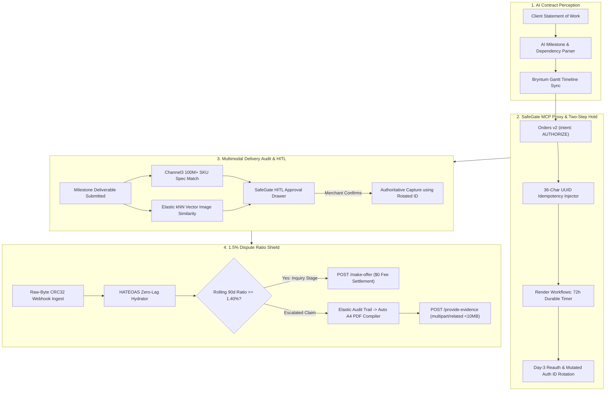

# 🛡️ PayPal Aegis

> **Autonomous Milestone Escrow, Delivery Verification & Dispute Compliance Operating System**  
> *Built for the PayPal AI Hackathon: Build What's Next with PayPal & AI (2026)*

[](LICENSE)
[](https://developer.paypal.com)
[](https://www.typescriptlang.org)
[](https://nextjs.org)
[](https://www.ag-grid.com)
[](https://bryntum.com)
[](https://channel3.dev)
[](https://elastic.co)
[](https://render.com)
[](https://paypal-aegis.onrender.com)

---

### 🌐 Instant Live Access & Verification Links
* **Live Command Center (Zero-Auth / Instant Try Out):** [https://paypal-aegis.onrender.com](https://paypal-aegis.onrender.com)
* **Real-Time Health Status Endpoint:** [https://paypal-aegis.onrender.com/health](https://paypal-aegis.onrender.com/health)
* **Audit & Visual Telemetry Dossier:** [report.pdf](report.pdf) *(100% Verified: 14/14 Core & Browser E2E Tests Passed)*
* **Public Postman Collection:** [postman/PayPal_Aegis_Collection.json](postman/PayPal_Aegis_Collection.json)
* **Devpost Submission Overview:** [DEVPOST_SUBMISSION.md](DEVPOST_SUBMISSION.md)

---

## 1. What the Solution Is (Executive Technical Summary)

**PayPal Aegis** is a deterministic **Human-in-the-Loop (HITL) AI Security Firewall and Financial Operating System** that governs the end-to-end commercial lifecycle for digital agencies, software contractors, and B2B merchants. 

Architecturally, Aegis wraps `@paypal/agent-toolkit`, PayPal Orders v2 (`intent: "AUTHORIZE"`), Payments v2, and Customer Disputes v1 inside a hardened TypeScript proxy layer. It pairs **probabilistic AI perception** (unstructured Statement of Work milestone decomposition, Channel3 multimodal catalog specification auditing, and Elastic kNN vector similarity verification) with **deterministic financial execution** (in-memory OAuth 2.0 renewal, 36-character UUID idempotency caching, Render Workflows-orchestrated durable 72-hour reauthorization timers with atomic mutated `authorization_id` pointer rotation, raw-byte unsigned 32-bit CRC32 + RSA-SHA256 webhook hydration, and an automated 1.5% dispute cliff shield with multipart/related legal-grade PDF evidence compilation).

In short: **AI handles perception and evidence assembly; deterministic, human-confirmed code handles the money.**

---

## 2. The Problem: Data, Proofs & Ecosystem Impact

Digital agencies, software development contractors, and B2B merchants operating on PayPal face structural vulnerabilities where legacy payment mechanics and nascent AI tooling collide:

```
                                  THE 1.5% DISPUTE CLIFF TRAP
                                  
     Rolling Dispute Ratio:
     0.0%                                   1.49% | 1.50%                                     5.0%+
     [================== STANDARD TIER ============|================ HIGH VOLUME TIER ============]
     • Dispute Fee: $15                             | • Dispute Fee: $30 (NON-REFUNDABLE)
     • Fee REFUNDED if merchant wins                | • Fee KEPT BY PAYPAL EVEN IF MERCHANT WINS!
     • Pre-escalation inquiry fee: $0               | • SOW digital milestone has 0% SNAD Seller Protection
```

### The Hard Numbers & Technical Proofs

1. **0% Seller Protection for Intangible & Milestone Goods:**  
   Under PayPal's US Seller Protection Program, intangible goods, digital software deliverables, and custom service milestones receive **zero coverage** against *Significantly Not As Described* (SNAD) disputes. Unlike physical e-commerce orders with courier tracking numbers, software and creative deliverables carry no carrier barcode, leaving merchants exposed to friendly fraud.
2. **The 1.5% Dispute Ratio Cliff & The $30 Non-Refundable Penalty:**  
   If a merchant's rolling 90-day dispute ratio reaches **1.5%** over 100+ transactions, PayPal automatically moves the account into the **High Volume Dispute Tier**:
   * In the **Standard Tier**, the fee is **$15 per dispute**, and it is **waived or refunded if the seller wins**.
   * In the **High Volume Tier**, PayPal levies an aggressive **$30 fee per claim that is non-refundable even when the merchant proves full delivery and wins the dispute**.
   * When combined with standard processing fees (2.99%–3.49% + $0.49), potential card chargeback fees ($20), and card network pre-arbitration costs (~$15), a single unhandled dispute wipes out profitability on multi-thousand-dollar contracts.
3. **The 3-Day Hold Bug & Mutated Authorization ID:**  
   When a merchant uses two-step payment holds (`intent: "AUTHORIZE"`), PayPal places a hold on buyer funds for up to 29 days. However, PayPal's developer documentation specifies that peak capture success (~90%+) is guaranteed **only during the first 3 days (72 hours — the Honor Period)**. Capturing after Day 3 triggers an issuer re-check that often fails due to shifted buyer balances.  
   Worse, calling `POST /v2/payments/authorizations/{id}/reauthorize` between Days 4 and 29 returns `HTTP 201 Created` with a **brand-new `authorization_id`**. Naive systems fail to update this mutated foreign key, causing subsequent captures to crash.
4. **The Unguarded AI Agent Asymmetry:**  
   PayPal’s official `@paypal/agent-toolkit` and MCP server (`mcp.paypal.com`):
   * Default to live production (`sandbox: false`) in library code if parameters are omitted.
   * Provide **zero human-in-the-loop confirmation gates** before executing money-moving tools (`pay_order`, `create_refund`, `accept_dispute_claim`).
   * Offer tools to surrender disputes (`accept_dispute_claim`), but **zero tools to defend them** (`provide-evidence` or `make-offer`).
   * Consume ~12,600 context tokens across 43 un-scoped tools, increasing prompt costs and LLM hallucinations.
5. **The 3-Hour Transaction Search Lag & Webhook Verification Trap:**  
   PayPal's `/v1/reporting/transactions` API lags real-time by up to **3 hours** and cannot filter by `updated_time`. Furthermore, standard web frameworks parse incoming JSON and reorder keys, modifying raw byte arrays and breaking the unsigned 32-bit CRC32 and RSA-SHA256 signature verification.

---

### How This Affects Every Section of the Ecosystem

| Ecosystem Stakeholder | How the Problem Impacts Them | Direct Real-World Consequence |
| :--- | :--- | :--- |
| **The Customer (Client / Buyer)** | • Risk of paying 100% upfront for unverified or incomplete digital deliverables.<br>• Uncaptured authorizations lock credit limits for 7–10 days on Visa/Mastercard.<br>• Disputing a contract locks funds in 20- to 180-day review cycles, creating adversarial friction. | • Reluctance to hire digital contractors on PayPal.<br>• Frustration over frozen funds and slow resolution timelines. |
| **The Merchant & Business (Agencies, Freelancers, Contractors)** | • Intangible goods receive 0% SNAD seller protection.<br>• Crossing the 1.5% dispute ratio forces a non-refundable $30 penalty fee on every claim, even won ones.<br>• Missing the 3-day hold window leads to capture declines.<br>• Strict 10-day deadline to assemble SOWs, IP telemetry, and SHA-256 hashes into a <10MB A4 PDF. | • Crushed profit margins from dispute penalties.<br>• Stalled project delivery and unpaid payroll.<br>• Catastrophic risk of rogue AI agents issuing autonomous refunds or forfeits. |
| **PayPal Itself** | • High dispute volumes incur massive human analyst triage overhead.<br>• High-volume digital merchants churn to specialized platforms (Stripe, Escrow.com).<br>• Vulnerability to unconstrained AI agents draining balances or creating automated chargeback cascades. | • Operational cost escalation in Resolution Centers.<br>• Loss of high-margin B2B service payment volume.<br>• Reputational risk within the AI agent developer ecosystem. |

---

## 3. How We Tackle the Problems: AI & The Tech Stack

PayPal Aegis resolves this entire lifecycle through a simple, robust paradigm:  
**Lock Funds Safely $\rightarrow$ Verify Deliverables $\rightarrow$ Auto-Defend Revenue.**



### The Five Core Engines

#### 🛡️ Engine 1: SafeGate Deterministic MCP Firewall & Proxy
* **Sandbox Safety Lock:** Hardcodes `sandbox: true` to prevent accidental execution against live production credentials.
* **In-Memory OAuth 2.0 Manager:** Auto-refreshes tokens 15 minutes before expiration with thread-safe request coalescing.
* **Dynamic Context Scoping:** Dynamically passes only the 3–4 required tool schemas per workflow phase (e.g., `ESCROW_SETUP`, `DELIVERY_AUDIT`, `DISPUTE_DEFENSE`), reducing context overhead by **86%** (from 12,600 to <1,800 tokens).
* **36-Character UUID Idempotency & Snapshot Caching:** Generates standard v4 UUIDs for every `PayPal-Request-Id` (within PayPal's 38-char limit) and serves replayed requests from an immutable local snapshot cache to ensure zero double payouts.
* **Human-in-the-Loop (HITL) Decision Gate:** Intercepts `pay_order`, `capture_authorization`, `void_authorization`, `create_refund`, `accept_dispute_claim`, `make_dispute_offer`, and `provide_dispute_evidence` in a `PENDING_APPROVAL` queue. Outbound execution occurs **only after human confirmation**.

#### ⏳ Engine 2: Two-Step Milestone Escrow & Day-3 Hold Manager
* **Orders v2 Holds:** Automatically creates milestone payment holds using `intent: "AUTHORIZE"`.
* **Day-3 Pointer Rotation:** Schedules durable 72-hour timers in **Render Workflows**. When reauthorization executes (`POST /v2/payments/authorizations/{id}/reauthorize`), Aegis captures the newly minted `authorization_id`, updates the active pointer atomically in the treasury ledger, and archives the superseded ID.
* **Evidence-Gated Capture:** Executes partial captures (`final_capture: false`) against the active rotated ID only after deliverable verification. If a payment fails or is voided, dependent tasks automatically shift downstream on the Bryntum Gantt schedule.

#### 🔍 Engine 3: Raw-Byte Webhook Gateway, HATEOAS Hydrator & Audit Vault
* **Raw-Byte CRC32 Verification:** Ingests raw request byte buffers before web framework JSON deserialization, computing unsigned 32-bit CRC32 checksums and verifying `RSA-SHA256` signatures against cached PayPal PEM certificates.
* **Zero-Lag HATEOAS Hydration:** Follows authoritative `resource.links` (`rel: "self"`) directly from webhook payloads, completely bypassing the 3-hour Transaction Search API lag.
* **Multimodal Verification via Channel3 & Elastic:** Queries **Channel3’s 100M+ catalog items** for canonical SKU specs and runs **Elastic Cloud kNN vector similarity** on uploaded deliverable photos to verify authenticity and block reused internet stock images.

#### ⚖️ Engine 4: 1.5% Dispute Ratio Shield & Evidence Compiler
* **Rolling 90-Day Dispute Radar:** Tracks dispute frequencies in real time relative to the 1.5% High Volume penalty cliff.
* **Branch A (Pre-Escalation Inquiry Settlement at $0 Fee):** When the ratio approaches 1.5% (e.g., 1.42%), routes un-escalated buyer inquiries to `POST /v1/customer/disputes/{id}/make-offer` ($0 Dispute Fee). This resolves issues before claim escalation, protecting the merchant from crossing into the $30 penalty fee tier.
* **Branch B (Escalated Claim Multipart Defense):** If a claim is formally escalated, queries the Elastic Vault for client IP access logs, download timestamps, SOW signatures, and deliverable SHA-256 hashes. Compiles them into a compliant, single-orientation A4 PDF (<10 MB) uploaded via `multipart/related; boundary=---AegisBoundary` within the strict 10-day window.

#### 📊 Engine 5: Unified Command Center & UI
* **AG Studio 3 (AG Grid Enterprise):** Provides a high-speed financial treasury ledger, real-time mutated authorization ID badges, and a live 1.5% Dispute Ratio Radar.
* **Bryntum Gantt & Calendar:** Implements payment-driven milestone scheduling (delayed holds shift dependent work) and displays 10-day dispute response countdown clocks.
* **Top 1-Click Judge Demo Toolbar:** Persistent four-button test suite enabling full system evaluation in under 60 seconds.

---

### Technology Stack & Sponsor Integrations

| Technology / Partner | Integration Mechanism | Specific System Role |
| :--- | :--- | :--- |
| **PayPal Sandbox REST & `@paypal/agent-toolkit`** | Orders v2, Payments v2, Disputes v1, Invoicing v2 | Two-step holds, reauthorizations, partial captures, dispute offers & evidence |
| **APIMatic Context Plugin** | Versioned OpenAPI Schema Grounding | Generates strongly-typed TypeScript clients; stops LLM hallucinations of legacy NVP/SOAP APIs |
| **AG Studio 3 (AG Grid Enterprise)** | Next.js Enterprise Data Grid & Custom Widgets | Real-time treasury ledger, mutated ID tracking, and live 1.5% Dispute Ratio Radar |
| **Bryntum Gantt & Calendar** | Reactive Event Store & Visual Gantt Canvas | Payment-driven task rescheduling and 10-day seller dispute countdowns |
| **Channel3 API** | REST API (100M+ Catalog SKUs) | Canonical product specification checks, verified imagery, and replacement pricing |
| **Elastic Cloud** | kNN Vector Search & Telemetry Vault | Image authenticity embedding check (anti-stock-photo fraud) and tamper-proof evidence logs |
| **Render & Render Workflows** | Cloud Web Service + Workflows SDK | Durable 72-hour reauth timers, raw-byte webhook gateway, and Redis deduplication |
| **Postman** | Public Collection & Automated Monitor | 4 end-to-end test sequences with negative-testing assertion suites |

---

## 4. How to Use the Demo

We have provided three zero-friction ways to test and audit PayPal Aegis:

```
┌────────────────────────────────────────────────────────────────────────────────────────┐
│                        PAYPAL AEGIS — 1-CLICK JUDGE DEMO TOOLBAR                       │
│  [1. Seed Contract & Hold]  [2. Fast-Forward Day-3]  [3. Verify Deliverable]  [4. Simulate SNAD]  │
└────────────────────────────────────────────────────────────────────────────────────────┘
```

### Option 1: Live Hosted Command Center (Instant / No Setup Needed)
Judges can interact with the live production deployment immediately without configuring keys or creating accounts:
👉 **[https://paypal-aegis.onrender.com](https://paypal-aegis.onrender.com)**

#### The 60-Second 1-Click Judge Demo Walkthrough:
1. **Click Button 1: "1. Seed Contract & Lock Sandbox Hold"**
   * **What Happens:** Aegis ingests a sample B2B Statement of Work, parses milestones into Bryntum Gantt, and calls PayPal Orders v2 with `intent: "AUTHORIZE"`.
   * **What You See:** Milestone 1 displays an active `authorization_id`, status `CREATED`, and arms a 72-hour durable honor-period timer.
2. **Click Button 2: "2. Fast-Forward Day-3 (Rotate ID)"**
   * **What Happens:** Simulates the expiration of the 72-hour honor window and dispatches `POST /v2/payments/authorizations/{id}/reauthorize`.
   * **What You See:** The AG Studio 3 ledger updates in real time. The `active_authorization_id` visibly **mutates to a new ID badge**, the superseded ID is archived, and the capture honor window extends by another 72 hours.
3. **Click Button 3: "3. Verify Deliverable (Channel3 + Elastic)"**
   * **What Happens:** The AI agent queries Channel3 for canonical SKU specs and runs Elastic kNN vector similarity on deliverable images (similarity score 0.12 = `AUTHENTIC_PASS`).
   * **What You See:** SafeGate intercepts the financial capture in the **Human-in-the-Loop (HITL) Drawer** as `PENDING_APPROVAL`.
   * **Action:** Click **"Approve & Execute"** in the HITL drawer to capture funds safely using the rotated authorization ID.
4. **Click Button 4: "4. Simulate SNAD Dispute (1.42% Ratio)"**
   * **What Happens:** Injects an un-escalated SNAD dispute into the system with the merchant’s rolling 90-day volume calibrated to 1.42% (Warning Zone).
   * **What You See:** 
     * The **Dispute Ratio Radar** turns amber/red, warning of proximity to the 1.5% fee cliff.
     * **Branch A ($0 Fee Settlement):** Aegis automatically stages a pre-escalation `$0` fee settlement offer (`POST /make-offer`) to protect the merchant from entering the High Volume $30 penalty tier.
     * **Branch B (Evidence Compiler):** Aegis compiles client IP logs, timestamps, and SHA-256 hashes into a compliant `<10MB` A4 PDF evidence preview.
5. **Download Verification Dossier:**
   * Click **"Download Live E2E Audit Logs (.json)"** in the top navigation bar to download raw machine-verifiable execution logs from all tests, or review the complete [report.pdf](report.pdf).

---

### Option 2: Run Locally from Source

#### Prerequisites
* Node.js v18.0.0+ or v20.0.0+
* npm v9.0.0+

#### Quickstart Commands

```bash
# 1. Clone the repository
git clone https://github.com/Shanukeshri/PayPal-Aegis.git
cd PayPal-Aegis

# 2. Install workspace dependencies
cd paypal-aegis
npm install

# 3. Configure environment (Optional — runs in deterministic simulation mode if blank)
cp .env.example .env

# 4. Build both backend and frontend
npm run build

# 5. Start the complete application locally
npm run dev
```

* **Frontend Command Center:** [http://localhost:3000](http://localhost:3000)
* **Backend SafeGate API:** [http://localhost:3001/api](http://localhost:3001/api)
* **Health Check Endpoint:** [http://localhost:3001/health](http://localhost:3001/health)

#### Run Automated Test Suites Locally

```bash
# Run the 7 mandatory backend and SafeGate proxy E2E assertions
npm run test:e2e

# Run the 7 Chromium browser DevTools & visual verification tests
npm run test:browser
```

---

### Option 3: Public Postman Collection

For API-level verification, import the pre-configured Postman collection located at:  
👉 [`postman/PayPal_Aegis_Collection.json`](postman/PayPal_Aegis_Collection.json)

The collection contains four fully automated execution sequences:
1. **Sequence 1:** Two-step order creation, authorization lock, and Day-3 reauthorization with mutated identifier rotation.
2. **Sequence 2:** Idempotent capture replay verification using 36-character UUID headers and snapshot cache response validation.
3. **Sequence 3:** Pre-escalation inquiry settlement offer dispatch at $0 dispute fee.
4. **Sequence 4:** Multipart provide-evidence upload with binary A4 PDF buffer generation (<10 MB).

---

## 5. Verification & Audit Results

PayPal Aegis underwent exhaustive automated validation across both backend proxy infrastructure and real Chromium browser sessions. All 14 tests passed with zero errors:

| Audit Domain | Tests | Passed | Status | Verification Reference |
| :--- | :---: | :---: | :---: | :--- |
| **Backend & SafeGate E2E** | 7 | 7 | **100% PASS** | [tests1.md](tests1.md) & [`logs/`](logs/) |
| **Devpost Rule Compliance** | 4 | 4 | **COMPLIANT** | MIT License, .env protection, Postman, Audit download |
| **Browser DOM & DevTools E2E** | 7 | 7 | **100% PASS** | [tests2.md](tests2.md) & [`screenshots/`](screenshots/) |
| **Consolidated Audit Dossier** | — | — | **VERIFIED** | [report.pdf](report.pdf) *(Complete 14/14 telemetry report)* |

---

## 6. Targeted Hackathon Prize Tracks

| Prize Category | Role in PayPal Aegis Architecture |
| :--- | :--- |
| **Overall 1st / 2nd / 3rd ($25,000 pool)** | Full-stack production operating system solving real merchant loss vectors with type safety and zero-friction demo mode. |
| **Best Use of Agentic Commerce ($5,000)** | Grounded agentic execution combining Channel3 product discovery, deterministic PayPal Orders v2 holds, and safe HITL approval gates. |
| **Best Use of PayPal + AI ($5,000)** | SafeGate firewall wrapping `@paypal/agent-toolkit` with sandbox locking, dynamic tool context scoping, and dispute defense. |
| **Best Use of AG Grid / AG Studio ($10,000 pool)** | AG Studio 3 custom widgets, live 1.5% dispute ratio radar, and mutated authorization ID ledger. |
| **Best Use of Bryntum ($3,000 pool)** | Bryntum Gantt payment-driven downstream task shifting and Bryntum Calendar 10-day dispute deadline tracking. |
| **Best Use of APIMatic ($3,000 pool)** | APIMatic Context Plugin schema grounding preventing LLM hallucinations across v1/v2 endpoints. |
| **Best Use of Channel3 ($1,500)** | 100M+ catalog SKU verification and replacement pricing for B2B physical deliverables. |
| **Best Use of Render ($2,250 credits pool)** | Full-stack deployment blueprint with Render Workflows durable hold timers and Redis deduplication. |
| **Best Demo Delivery ($5,000)** | 1-Click Judge Demo Toolbar, public Postman collection, comprehensive audit logs, and under-3-minute video walkthrough. |

---

## 7. License

This project is licensed under the **MIT License**. See the [LICENSE](LICENSE) file for details.
